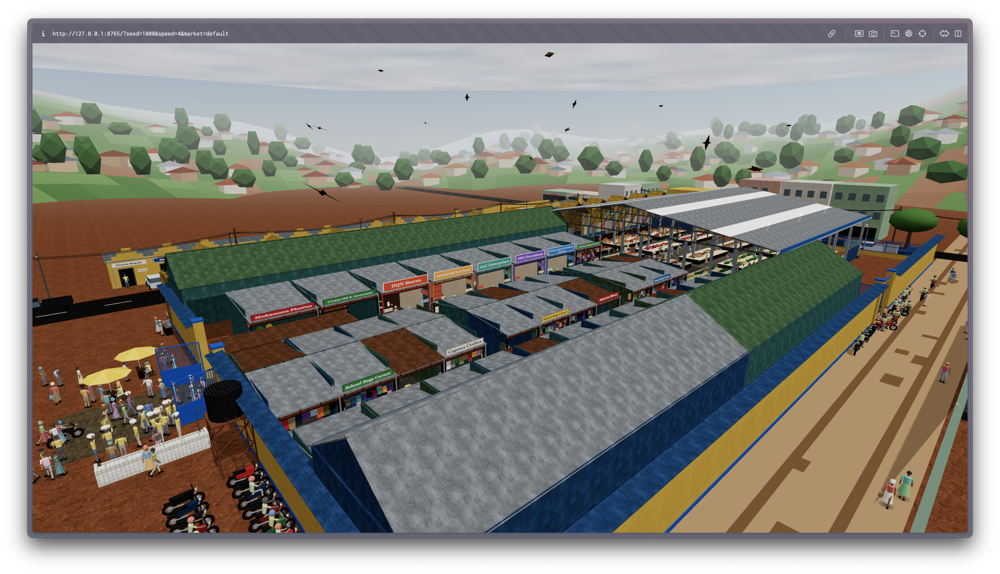
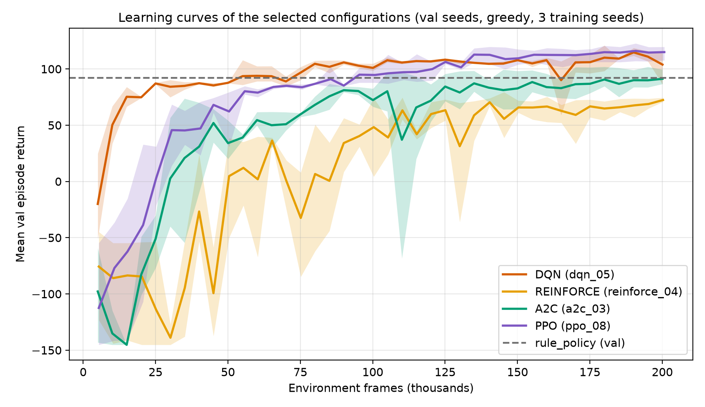
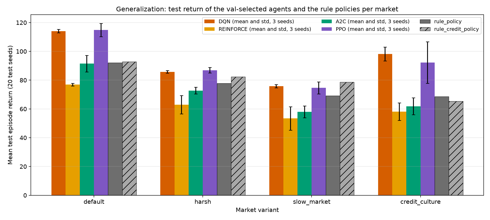

# Beyond Sale Shop Manager: Mission-Based Reinforcement Learning

A simulated Nigerian provisions shop where one step is one trading day and one episode is 90 days.
The agent picks the owner's daily decision: restocking, opening rice bags, pricing, credit and chasing debts.
DQN, REINFORCE, A2C and PPO are trained in TorchRL on the same environment and compared with a rule-based owner.

Video demo: [ADD LINK]

<!-- Screenshot of the 3D market, added after UI polish. -->


## Quick start

```
uv sync
uv run main.py
```

This opens the 3D Kimironko market in your browser. Five shops trade the same 90 days side by side: the
four trained agents (DQN, REINFORCE, A2C, PPO from `models/best/`) and Mama Ngozi, the rule-based owner.
The terminal prints one block per day and a final leaderboard.

Main options (`uv run main.py` and `uv run play.py` take the same ones):

| Option | Meaning |
|---|---|
| `--seed 1000` | Episode seed; the same seed gives the same customers to every shop |
| `--market default` | `default` or `harsh` |
| `--speed 1` | Playback speed; 1 means 8 seconds per day |
| `--no-browser` | Do not open a browser; just serve the page and print the days |
| `--port 8765` | Port of the local server |

In the browser:

| Control | Action |
|---|---|
| Overview, Walk, Tour buttons (or O, F, T) | Camera modes: view down the lane, first-person walk (W A S D, Shift), cinematic tour |
| Keys 1 to 5, or click a shop or card | Step inside a shop: chalkboard with today's decision and top 3 choices |
| Esc | Leave the shop or the tour |
| H | Photo mode (hide the panels) |
| Space, Q, M, ? | Pause, quality low or high, sound on or off, key list |

## Environment

Gymnasium environment `environment/custom_env.py` (`ShopEnv`), all numbers in `environment/config.py`.
The report has the full description.

**Actions** (13, discrete):

| # | Action | # | Action |
|---|---|---|---|
| 0 | hold | 7 | open rice bag (into loose rice) |
| 1, 2 | restock noodles small, large | 8 | raise price band |
| 3, 4 | restock soap small, large | 9 | lower price band |
| 5, 6 | restock rice bags small, large | 10, 11 | credit open, credit strict |
| | | 12 | chase debts |

**Observation:** 23 values, each clipped to [0, 1]: stock of the four products, pending deliveries, cash,
recent and old debt, trust, price band, credit policy, average recent sales, haggle success rate,
default share, weekday, days to month end (payday), day of episode, and customers lost today.

**Reward** for each day:

```
reward = (wealth today - wealth yesterday) / 10,000
         - 0.02 x customers lost today
         - 1.0 if the action was invalid
         + on day 90: 0.5 x outstanding debt / 10,000
         - 10 if cash falls below zero
```

Wealth is cash plus stock and pending stock valued at cost.

**Start state:** cash of 200,000, stock at a seeded random 80 to 120 percent of its base level,
no debts, trust 0.7, normal price band, strict credit, random weekday and day of month.

**Episode end:** day 90, or bankruptcy when cash falls below zero. Both are terminal.

**Markets:** `default`, `harsh` (0.8x customer arrivals, 2x debt defaults),
`slow_market` (0.7x arrivals) and `credit_culture` (40 percent of customers ask for credit, 1.5x defaults).
`price_scale` only rescales money and is kept for the frozen tests.

## Results

Greedy policy on the 20 test seeds (1000 to 1019), default market. For each algorithm, the configuration
was chosen on validation seeds only; the return is the mean ± std over 3 training seeds.
Numbers are read from `logs/generalization.csv` (also in `assets/tables/t5_final_comparison.md`).

| Policy | Config | Test return (mean ± std, 3 seeds) | Test net worth (NGN, mean) |
|---|---|---|---|
| DQN | dqn_05 (gamma 0.999) | 114.10 ± 1.24 | 1,793,872 |
| REINFORCE | reinforce_04 (gamma 0.95) | 76.93 ± 0.92 | 1,456,629 |
| A2C | a2c_03 (learning rate 2e-3) | 91.47 ± 5.72 | 1,564,753 |
| PPO | ppo_08 (entropy coefficient 0.05) | 114.86 ± 4.60 | 1,793,990 |
| Rule-based owner (rule_policy) | fixed rules | 92.14 | 1,576,626 |





All figures are in `assets/figures/` and all tables in `assets/tables/`.

## Reproduce

The environment is frozen at git tag `env-v1`; every result was produced with that version of the dynamics.

```
uv run pytest -q                                              # all tests
uv run python -m training.pg_training --algo ppo --exp-id ppo_08   # one experiment
uv run python -m training.dqn_training --exp-id dqn_05             # one DQN experiment
uv run python -m training.run_sweeps --workers 3                   # full sweep, all four algorithms
uv run python -m training.run_sweeps --only dqn_05,reinforce_04,a2c_03,ppo_08 --seeds 3   # extra seeds
uv run python -m analysis.select_best                             # pick each algorithm's config on validation
uv run python -m analysis.generalization                          # test the winners in all four markets
uv run python -m analysis.export_best                             # copy the chosen checkpoints to models/best/
uv run python -m analysis.make_figures                            # assets/figures/
uv run python -m analysis.make_tables                             # assets/tables/
```

Training logs go to `logs/<algo>/`, checkpoints to `models/dqn/` and `models/pg/<algo>/`, and one summary row
per run to `logs/summary.csv`. The full sweep is 51 experiments of 200,000 frames each.

## Integration

The simulation can drive other front ends through a small local HTTP server (`play.py`):

- `GET /api/meta` returns JSON: the five shops, products, start cash, episode length, seed and markets.
- `GET /api/stream?seed=1000&market=default&speed=1&from_day=1` is a Server-Sent Events stream: one `init`
  event with day 0, one unnamed event per day (each shop's action, reward, state, sales, haggles, top 3 scores,
  and the leaderboard), then one `end` event with the final leaderboard.
- `ShopEnv.get_state()` returns a JSON-serializable snapshot of the shop: day, cash, stock, pending, price band,
  credit policy, trust, debts and lost customers.
- Checkpoints are `.pt` files holding `{"state_dict", "config", "extra"}`. `training.common.load_checkpoint(path,
  build_fn)` rebuilds the network from the saved config and loads the weights (`build_value_net` for DQN,
  `build_logits_net` for the policy gradient methods).

## Project structure

```
environment/   the Gymnasium shop environment, its config and market variants, and the baseline policies
training/      DQN and policy gradient training in TorchRL, the experiment lists and the sweep runner
analysis/      model selection, generalization, checkpoint export, figures and tables
models/        all checkpoints; models/best/ holds the four chosen agents used by the market view
logs/          training and evaluation logs, summary.csv, selection.csv and generalization.csv
assets/        web/ (the 3D market), figures/, tables/ and CREDITS.md
tests/         environment, training, experiment and rendering tests
play.py        the market server and terminal output; main.py runs it
```

## Hardware note

Tested on an Intel Mac, CPU only. torch is pinned to 2.2.2, the last version with Intel Mac wheels, so the
same lock file installs on Intel Mac, Apple Silicon, Linux and Windows.

## Credits

Textures, the three.js library and its add-ons are listed with their sources and licences in
[assets/CREDITS.md](assets/CREDITS.md). Everything else in the 3D market is generated in code.
